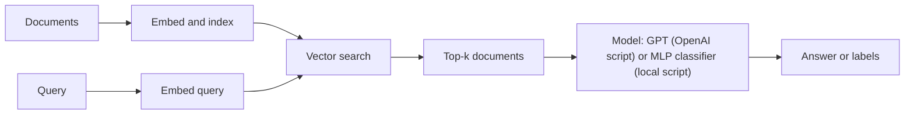

# MicroLLM

RAG from first principles in about 110 lines of Python: embed, search, answer. A teaching prototype, not a service.

Two small scripts show the same retrieval idea two ways. One uses OpenAI and LangChain. The other runs entirely on your machine.

## What it shows

- **Embeddings and vector search, in memory.** Documents are embedded and searched with nothing persisted: Chroma in one script, a FAISS flat index in the other.
- **A hosted RAG chain.** `rag_pipeline_with_openapi.py` (35 lines) wires OpenAI embeddings, a Chroma retriever and `gpt-3.5-turbo` together with LangChain's `RetrievalQA`.
- **A fully local variant.** `locally_trained_model_for_rag pipeline.py` (78 lines) uses `all-MiniLM-L6-v2` from SentenceTransformers for embeddings and FAISS for search. It needs no API key.
- **Retrieval feeding a model.** In the local script the model is a small scikit-learn MLP sentiment classifier (TF-IDF features) that labels whatever was retrieved. It is a stand-in for an LLM, to keep the example free and offline.

## Pipeline



## Run it

Python 3.9+. There is no `requirements.txt`, so install what the script imports.

Local script (no key needed; downloads the embedding model on first run):

```sh
pip install numpy faiss-cpu scikit-learn sentence-transformers
python "locally_trained_model_for_rag pipeline.py"
```

It prints the classifier's accuracy, then the two documents closest to the query "Was the movie good or bad?" with a Positive/Negative label each.

OpenAI script (needs your own key, in a `.env` file that `.gitignore` already excludes):

```sh
pip install python-dotenv langchain langchain-community langchain-openai chromadb
echo 'OPENAI_API_KEY=<your-key>' > .env
python rag_pipeline_with_openapi.py
```

The OpenAI script is not pinned to library versions and uses LangChain's older `RetrievalQA` API, so on a recent LangChain it may need small import changes. The local classifier trains on six sentences, so its labels are illustrative: the point is the plumbing, not the accuracy.

## What it leaves out

Deliberately, to stay readable:

- Document chunking, so each "document" is one short string.
- Persistence: the index is rebuilt on every run.
- Any real corpus, ingestion, or an API around it.
- Evaluation, tests, error handling, auth, deployment.

The fuller version of this idea, built as an actual RAG service, is [smart-system](https://github.com/usman250994/smart-system). Start there if you want something closer to production, and here if you want to see the moving parts with nothing hidden.

Background posts: [the OpenAI version](https://mani9418.medium.com/my-first-micro-llm-in-python-build-a-mini-rag-system-in-minutes-582ba6dc0931) and [the local version](https://mani9418.medium.com/learning-rag-the-local-way-build-a-free-in-memory-retriever-classifier-212824765ff2) on Medium.

## License

See [LICENSE](LICENSE).

---

Built by Usman Ali Siddiqui · [maanizstudio.com](https://www.maanizstudio.com)
